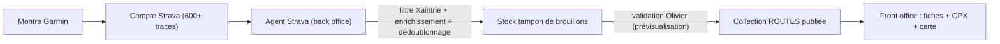
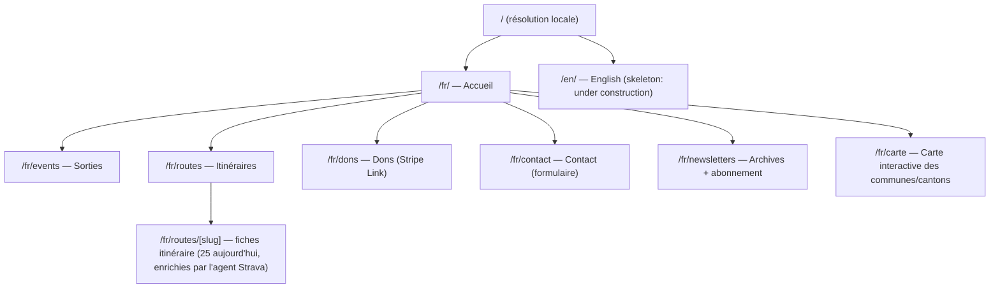
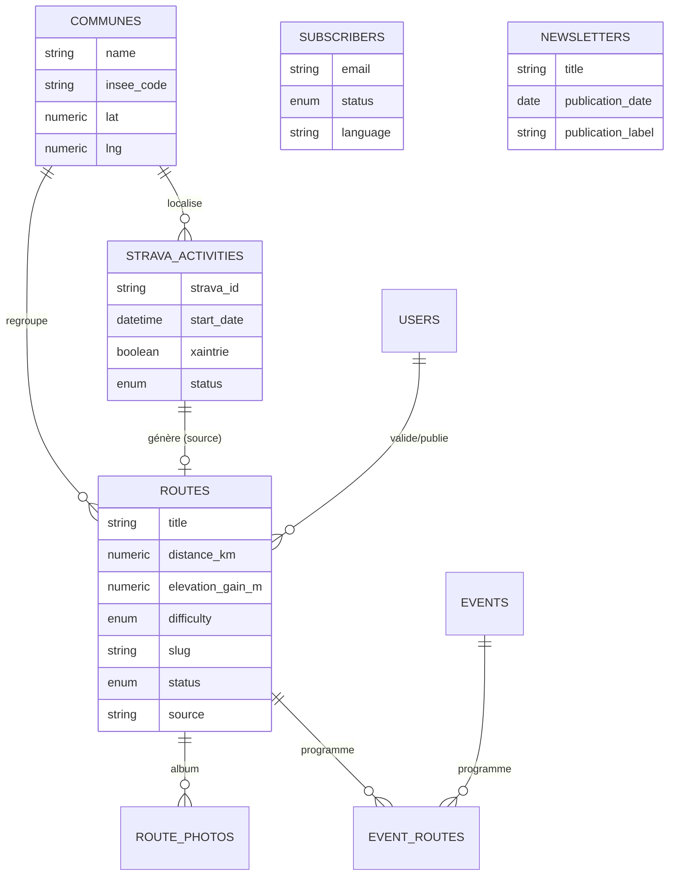

# Spécifications — Refonte de cheminsetfontaines.fr

**Version** : 1.2 · **Date** : 25/11/2026
**Statut** : spécifications validées, chantier en cours d'exécution (l'état précis vit dans `docs/ROADMAP.md`) ; servira de gabarit pour les spécifications SylvaGreen Management.

**Journal des versions** :

- **v1.0** (22/11/2026) : document initial — relevé Framer factuel, architecture cible, questions Q1-Q18.
- **v1.1** (22-23/11/2026) : arbitrages des questions structurantes ; lancement du chantier acté le 23/11.
- **v1.2** (25/11/2026, mise à jour après livraison) : **remplacement Mailchimp réorienté en développement 100 % interne** (envoi direct SMTP Gandi via Nodemailer derrière un `MailService` abstrait ; Brevo relégué au rang de plan B délivrabilité ; décisions D1-D6 actées le 25/11) — remplace la décision « Brevo » (Q15) du 22/11 ; **Q7 résolu : hébergement Vercel (Hobby) + PostgreSQL géré Neon eu-central-1, déployé le 24/11** ; **livrés depuis v1.1** : back-office complet auth + CRUD itinéraires + uploads (B0-B4), viewer GPX satellite 3D avec capture 1200×800 (suppression de Gimp), migration des contenus réels (25 GPX + images auto-hébergés, plus aucune image visible servie par un CDN externe), parcours e-mails interne N0→N3 (socle MailService, double opt-in souscripteurs, adhérents à l'anniversaire de paiement, concepteur de newsletters WYSIWYG façon Mailchimp avec drag & drop et édition en place) ; **Q3/Q18 quasi clos** ; détail architectural du programme e-mail interne dans la spec dédiée du 25/11 (canvas « cf-spec-remplacement-mailchimp », source de vérité D1-D6).

## 1. Objet, périmètre et sources

### 1.1 Objet

Recréer **en code** (indépendance totale vis-à-vis de Framer) l'écosystème complet de l'association Chemins et Fontaines (Bassignac-le-Haut, Corrèze) :

1. **Le front office** : le site public `cheminsetfontaines.fr` (itinéraires GPX par commune et par carte interactive, sorties, dons, contact, newsletters).
2. **Le back office** : une administration authentifiée qui publie le front office (CRUD des collections, workflow de validation, analytics) **et qui intègre un agent intelligent Strava** générant automatiquement des itinéraires depuis les ~600 traces Garmin/Strava d'Olivier, dans un **stock tampon de prévisualisation** avant publication.

Le chantier sert de **répétition générale** au futur back-office SylvaGreen Management : chaque composant (authentification = rôles, itinéraires = fiches d'affaire, GPX = pièces documentaires, agent IA = pattern d'enrichissement automatique) doit être réutilisable.

### 1.2 Sources analysées

1. **36 captures d'écrans** du workspace Framer (document Word fourni), dont 20 analysées en détail cette session : dashboards, menus, 5 collections CMS, Analytics, Settings, domaines, plugins.
2. **Le site public actuel** consulté en direct : home, `/fr/routes`, `/fr/events`, `/fr/carte`, `/fr/newsletters`, `/fr/dons`, `/fr/contact`, `/en/`, et **`sitemap.xml` complet**.
3. **Bibliothèque projet** : logos, images officielles, QR code, logo AFM Téléthon, comptes-rendus d'AG 2026.
4. **Inputs du 22/11/2026 (Olivier)** : distinction front office / back office, agent Strava (600+ traces Garmin collectées via sa montre, stockées sur Strava), carte interactive des cantons à habiliter, remplacement de Mailchimp (coût), Stripe "Link" pour les dons.

## 2. Terminologie et vision d'ensemble

| Terme | Définition |
|---|---|
| **Front office** | Site public `cheminsetfontaines.fr`, génération statique (SSG/ISR), mobile-first |
| **Back office** | Application d'administration authentifiée (admin + bureau), hébergée avec le front, URL non indexée |
| **Agent Strava** | Process automatisé qui lit les activités Garmin/Strava, filtre le périmètre Xaintrie, enrichit, et génère des **brouillons de routes** |
| **Stock tampon** | File de prévisualisation des routes générées (statut `brouillon`), qu'Olivier valide (`publié`) ou rejette (`rejeté`) avant apparition sur le front office |

Flux de valeur global :



## 3. Environnement Framer existant (relevé factuel)

### 3.1 Workspace et projet

- Workspace : **Olivier's Workspace**, plan **Pro**, un seul projet actif, nom interne "Pleasant Independence".
- Home dashboard : `Domains` (www.cheminsetfontaines.fr), `Projects > All / Archive`, `+ New folder`, tri "Last viewed by me".

### 3.2 Modules du projet (raccourcis observés)

| Module | Raccourci | Rôle constaté |
|---|---|---|
| Canvas | Alt+1 | Design des pages (Design, Pages, Layers, Assets) |
| CMS | Alt+2 | Collections, Fields, Plugins |
| Localization | Alt+3 | Gestion /fr, /en |
| Analytics | Alt+4 | Statistiques d'audience |
| Settings | Alt+5 | Site, Hosting, Page |

Pages du projet : **Home, /en/, /fr/**. Plugins disponibles : Google Sheets, Notion, Airtable, Ashby, HubSpot, CSV Import, CMS Export.

### 3.3 Hébergement et domaine

- Base : `pleasant-independence-325880.framer.app` (Ready) · Custom : `https://www.cheminsetfontaines.fr` (Ready).
- Sections Hosting : **Domains, Multi-site, Headers, Redirects, Firewall, Files** → à assumer côté auto-hébergé (headers de sécurité, redirections, fichiers GPX statiques).

### 3.4 Site (Settings > Site)

| Paramètre | Valeur | Transposition cible |
|---|---|---|
| Title | "My Framer Site" (non personnalisé) | Metadata par défaut + par page |
| Description | "Made with Framer" | Meta description |
| Language | French (fr) | Locale par défaut |
| Accessibility (reduced motion) | désactivé | Reprendre en CSS `prefers-reduced-motion` |
| Automatic locale redirect | **désactivé** | Pas d'auto-redirection /fr ↔ /en |

Autres sections : Skills, Performance, Versions (historique des déploiements), Usage, **Forms** (réception des soumissions), Plans, Code.

### 3.5 Analytics (23/10 → 22/11/2026)

- Unique visitors : **74** · Pageviews : **186** · Bounce : 51,3 % · Session moyenne : 3 min 36.
- Référents : google.com (21), Facebook (12), bing.com (1), xaintrie-val-dordogne.fr (1).
- Top pages : `/` 59, `/fr/routes` 18, 2 fiches Téléthon (18 + 10), `/fr/events` 7, `/fr/contact` 6.
- **Devices : mobile 49/74 (66 %)** → mobile-first obligatoire. Volumétrie faible : analytics légère auto-hébergée (Umami ou Plausible CE), pas d'entrepôt de données.

## 4. Architecture cible (décisions proposées, ouvertes à arbitrage)

| Brique | Choix proposé | Justification |
|---|---|---|
| Framework | **Next.js (App Router) + TypeScript**, monorepo unique front + back office | SSG/ISR pour le lecteur public, \`app/[locale]\` pour i18n, \`app/admin\` protégé |
| Données | **PostgreSQL + Prisma** | Modèle relationnel : collections, communes, traces Strava, drafts |
| Fichiers | Stockage fichier/objet + **Sharp** (images AVIF/WebP), GPX en statique | |
| Auth back office | Auth.js/NextAuth, rôles `admin` / `bureau` | Répétition générale du pattern SylvaGreen (rôles + MFA) |
| Carte front office | **SVG à l'identique** (réécriture React du composant Framer, voir §9.3) | Zéro dépendance, zéro tuile ; fidélité maximale (acté le 22/11) |
| Newsletter | **v1.2 : développement 100 % interne** — envoi SMTP Gandi direct (Nodemailer) derrière un `MailService` abstrait, rendu React Email (voir §9.2). Brevo abandonné, reste un plan B relais SMTP en cas de délivrabilité insuffisante | Suppression du coût Mailchimp, souveraineté des données |
| Dons | **Stripe Payment Link** intégré (voir §9.4) | Pas de secret en v1 |
| Agent Strava | Job interne Next.js (cron/manuel) + génération de texte par modèle Mistral (voir §7) | GPX + DB = plus simple app-side ; le modèle n'est appelé que pour le texte |
| Analytics | Umami ou Plausible CE auto-hébergé | RGPD, sans consentement pour mesure d'audience |
| Hébergement | **Acté le 24/11/2026 (Q7 clo)** : Vercel (plan Hobby) pour le site + PostgreSQL géré Neon (AWS eu-central-1, Frankfurt) ; le domaine cheminsetfontaines.fr ET la messagerie contact@ restent chez Gandi, seule la zone DNS web changera (**à la toute fin du chantier**) | Simplicité, CI/CD natif, UE, gratuit |
| Repo | GitHub via le connecteur GitHub App | Pattern validé |

## 5. Front office — arborescence (validée par sitemap.xml + navigation)



**Points constatés :**

- `/fr/routes/[slug]` : 25 fiches (slugs avec accents et tirets multiples : `afm-téléthon-2026---randonnée-12-kms`, `le-trou-du-loup`…) → **normalisation actée le 23/11/2026 (Q2)** : slugs cibles sans accents ni tirets multiples + **redirections 301** générées depuis la table de correspondance (à reviewer avant bascule) ; couvrira aussi l'incohérence `circuit-des-3-sapins` (titre « Marchands de Parapluie », §6.9).
- `/fr/routes` regroupe les fiches **par commune** (Township) : Albussac, Argentat, Auriac, Bassignac-le-Haut, Camps-St-Mathurin, Gros-Chastang, Goulles, Hautefage, Marcillac-La-Croisille, Rilhac-Xaintrie, Servières-le-Château.
- Home : hero + baseline, "Notre mission", "Prochaines sorties" (Events), "Itinéraires à télécharger" (Routes), CTA don / adhésion / newsletter, lien "Voir les archives".
- `/fr/carte` : "La carte des chemins", sélecteur parmi **30 communes de la Xaintrie** filtrant les itinéraires. **La carte interactive existe déjà comme composant** (`XaintrieTownshipMap.tsx`, SVG interactif cliquable par commune) mais n'est pas encore publiée sur la page : la copie du code source (22/11/2026) permet de la reproduire à l'identique.
- Pas de page `/fr/adhesion` dans le sitemap malgré le CTA "Devenir adhérent" → inconnue Q3.
- `/en/` : page "ENGLISH VERSION — UNDER CONSTRUCTION".

## 6. Modèle de données

### 6.1 Champs système communs (convention Framer → cible)

| Champ système | Rôle | Transposition cible |
|---|---|---|
| `Status` | `Live` / `Draft` par entrée | `status: enum('published','draft')` + `publishedAt` |
| `Slug` | URL auto-générable, éditable | unique, normalisation ASCII |
| `Created` / `Edited` | horodatages | `createdAt` / `updatedAt` |

### 6.2 Collection EVENTS (5 entrées)

| Champ | Type Framer | Exemple observé | Cible proposée |
|---|---|---|---|
| Title | Text | "AFM Téléthon 2026" | `title: string` |
| Date | Date | "31 OCT 2026 - 14:00" | `date: datetime` |
| Details | Text | "2 randonnées : 6kms facile... 12 kms plus techniques" | `details: text` |
| Image | Image | miniature | `image_id: FK media` |
| Draft | Booléen | toggle | fusionné dans `status` |

Recommandations : relation many-to-many **Events ↔ ROUTES** (aujourd'hui le lien n'est que textuel dans Details) ; `location: string` (point de rendez-vous) ; **les événements ne sont jamais masqués automatiquement** (Q6 acté le 22/11/2026 : reproduction du comportement Framer tel quel, gestion manuelle par l'équipe ; une automatisation éventuelle ne viendra que plus tard). **Précision Olivier du 22/11/2026 (comportement home)** : la page d'accueil affiche les **3 derniers événements, rafraîchis automatiquement** depuis la collection — à reproduire à l'identique (query « 3 plus récents » ; les brouillons Framer n'apparaissent pas).

### 6.3 Collection ROUTES (25 entrées) — cœur du site

| Champ | Type Framer | Exemple observé | Cible proposée |
|---|---|---|---|
| Title | Text | "AFM Téléthon 2026 - randonnée 12 kms" | `title: string` |
| Details | Text | "12 kms - dénivelé 280m - niveau facile" | **éclaté** (ci-dessous) |
| GPX File | Text | `rando_telethon_2026_12kms.gpx` | servira au téléchargement public |
| GPX Upload | Fichier | upload | `gpx_id: FK media` |
| Description | Text | "Randonnée organisée par..." | `description: text` |
| Route Image | Image | visuel principal | `image_id: FK media` |
| Township | Text | "Bassignac-Le-Haut" | **FK → Communes** |
| Photo Gallery | Référence | galerie Route Photos | relation 1-n |
| Has Photo Album | Booléen | lien "Album photos" sur la fiche | dérivable de l'existence de photos (champ supprimé en cible) |

**Éclatage du champ `Details`** (texte libre au format non constant : "12 kms - dénivellé 280m" / "16 km · 772 m D+ · niveau modéré") :

| Champ cible | Type | Valeurs |
|---|---|---|---n| `distance_km` | `numeric` | 6, 9, 12, 13, 14, 15, 16, 20… |
| `elevation_gain_m` | `numeric` | 100, 127, 167, 280, 466, 590, 772… |
| `difficulty` | `enum` | `facile`, `moyen`, `difficile` ("modéré" → `moyen` à la migration) |.

Uniquement nécessaire pour badges, **filtres de la carte interactive** et cohérence typographique.

### 6.4 Collection ROUTE PHOTOS (6 entrées)

| Champ | Type Framer | Exemple |
|---|---|---|
| Title | Text | "Sentier des 4 Puys — photo 1" |
| Image | Image | la photo |
| Route | **Référence Routes** | "Sentier des 4 Puys" |

Relation confirmée **Route Photos → Routes (n:1)** = album photo des fiches. Slug auto-dérivé.

**Photos des itinéraires — livraison du 22/11/2026** : dossier `03_Itineraires/Routes/<Commune>/` fourni par Olivier, contenu : toutes les photos **web ET originaux** (17 communes). **Règle actée : seules les versions `..._1200x800.png` (redimensionnées pour le site) doivent être utilisées sur le site** ; les `_original.png` sont conservés comme sources, jamais servis. 27 fichiers `1200x800` pour 25 itinéraires : mapping quasi biunivoque par nom de fichier, 2 surplus à arbitrer (« `blh_trou_du_loup_260909` » et « `route_soursac_viaduc_des_rochers_noirs` ») lors du mappings photo→slug. Les noms de communes du dossier confirment les variantes orthographiques à normaliser (§9.3).

### 6.5 Collection NEWSLETTERS (2 entrées)

| Champ | Type Framer | Exemple |
|---|---|---|
| Title | Text | "6 randonnées FFR de la Xaintrie" |
| Publication Date | Date | 02/09/2026 |
| Summary | Text | "L'association Chemins et Fontaines parcourt toute la Xaintrie…" |
| Cover Image | Image | forêt / paysage |
| Featured Route Or Township | Text | "Sélection de 6 randonnées FFR en Xaintrie" |
| Mailchimp Newsletter URL | URL | `mailchi.mp/campaign/...` |
| Publication Label | Text | "Septembre 2026" |

Aujourd'hui : archive de **liens** Mailchimp (le contenu vit chez Mailchimp). En cible, l'application devient l'outil d'envoi → le champ URL externe devient optionnel (voir §9.2).

### 6.6 Collection SUBSCRIBERS (0 entrée) — abonnés newsletter

Compris ainsi : **les internautes qui s'inscrivent au formulaire "Les nouvelles du sentier" de la home** (champs relevés : Email, Status, First Name, Last Name, Phone, Subscription Date, Language). Dans l'architecture cible, cette table devient la **source de vérité de la liste de diffusion** (contrepartie directe de l'audience Mailchimp), alimentée par double opt-in. Base vide aujourd'hui côté Framer.

Champs cible : `email` (unique), `first_name`, `last_name`, `phone` (optionnel), `language` (fr/en), `status` (`pending` → `subscribed` / `unsubscribed`), `confirmed_at`, `source` (formulaire, import), RGPD : consentement horodaté, page mentions + désinscription en un clic.

**(v1.2 — livré)** : modèle `Subscriber` avec double opt-in à jeton (pending → subscribed, jeton à usage unique valable 30 j, `unsubToken` + confirmation/désinscription en 1 clic, garde anti-renvoi 1 h), admin souscripteurs (renvoi, suppression RGPD) ; **import Mailchimp exécuté le 25/11 (D4)** : les 39 `subscribed` importés **sans re-demande d'opt-in** (marquage `source: import`, consentement horodaté Mailchimp conservé), les 5 `cleaned` exclues (script bureau `scripts/import-mailchimp.ts`, le CSV n'est jamais committé).

### 6.7 Tables nouvelles (ajouts de la refonte)

**COMMUNES** (issue du composant `XaintrieTownshipMap.tsx` copié le 22/11/2026 : les **30 communes de la Xaintrie y figurent avec leur code INSEE et leur polygone SVG exact** — Albussac 19004, Argentat-sur-Dordogne 19010, Auriac 19014, Bassignac-le-Bas 19017, Bassignac-le-Haut 19018, Camps-Saint-Mathurin-Léobazel 19034, Darazac 19069, Forgès 19084, Goulles 19086, Hautefage 19091, La-Chapelle-Saint-Géraud 19045, Mercœur 19133, Monceaux-sur-Dordogne 19140, Neuville 19149, Reygade 19171, Rilhac-Xaintrie 19173, Saint-Bonnet-Elvert 19186, Saint-Bonnet-les-Tours-de-Merle 19189, Saint-Chamant 19192, Saint-Cirgues-la-Loutre 19193, Saint-Geniez-ô-Merle 19205, Saint-Hilaire-Taurieux 19212, Saint-Julien-aux-Bois 19214, Saint-Julien-le-Pèlerin 19215, Saint-Martial-Entraygues 19221, Saint-Martin-la-Méanne 19222, Saint-Privat 19237, Saint-Sylvain 19245, Servières-le-Château 19258, Sexcles 19259) :

| Champ | Type | Rôle |
|---|---|---|
| `name` / `name_normalized` | string | "Bassignac-le-Haut" / "bassignac-le-haut" |
| `insee_code` | string | jointure IGN/Admin Express |
| `lat`, `lng` | numeric | centroïdes pour marqueurs sur la carte |
| `polygon_geojson` | json (optionnel) | contour pour sélection cartographique |

**STRAVA_ACTIVITIES** (journal d'import, une ligne par activité lue) :

| Champ | Type | Rôle |
|---|---|---|
| `strava_id` | string unique | identifiant Strava |
| `name`, `start_date`, `sport_type` | string, datetime, string | reprise des métadonnées Strava |
| `summary_polyline` | string | tracé encodé pour prévisualisation légère |
| `distance_m`, `elevation_gain_m`, `start_latlng` | numeric / json point | données de synthèse |
| `xaintrie` | boolean | résultat du filtre géographique |
| `commune_id` | FK nullable | reverse geocoding du point de départ |
| `imported_at`, `status` | datetime, enum | `hors_périmètre`, `candidat`, `draft_créé`, `rejeté`, `doublon` |
| `suggested_difficulty` | enum | calculée (distance × dénivelé) |

**ROUTES (extension)** : `source` (`saisie_manuelle` | `strava`), `source_strava_id` nullable, `created_by` (FK utilisateur), en plus des champs §6.3 éclatés. Principe : **publier = cloner le brouillon validé dans ROUTES** (le stock tampon ne pollue jamais les collections publiques).

### 6.8 Schéma relationnel cible (synthèse)



### 6.9 Relevé réel des exports CSV (dépôt du 22-23/11/2026, `00_Administratif/Framer/`)

Les 5 CSV du plugin CMS Export ont été reçus et intégrés. Constats :

- **Routes (25 lignes)** : valeurs complètes confirmées (titres, détails, descriptions, images, townships). Les **25 fichiers GPX ont été téléchargés depuis `framerusercontent.com/assets/`**, validés (XML conforme GPX 1.1 ; créateur `StravaGPX` pour 24 d'entre eux, `Tourism System` pour Entre Terre et Eaux : confirmation que les traces proviennent bien du cycle Garmin → Strava) et rangés dans `03_Itineraires/migration-auto/<slug>/trace.gpx` + côté serveur pour le seed du repo.
- **Events (5 lignes)** : 2 publiées (AFM Téléthon 2026, Fête du village 2026) + **3 brouillons = le programme à venir** (Boucle des cascades 14 SEPT., Bois et sources 28 SEPT., Panoramas d'automne 12 OCT.) — **dates sans année** dans les brouillons : à compléter à la publication. Répond partiellement à Q9 : le programme vit dans le CMS.
- **Subscribers : 0 ligne** (en-têtes seuls) — cohérent avec la collection vide ; l'export Mailchimp reste nécessaire.
- **Newsletters (2 lignes)** : URL Mailchimp complètes récupérées, labels de publication confirmés.
- **Route Photos (6 lignes)** : toutes avec URL image + slug de route lié.
- **Qualité de données relevée** : slug `circuit-des-3-sapins` porté par le titre "Chemins des Marchands de Parapluie" (incohérence titre/slug à arbitrer) ; GPX File "Sexcles_sentiier_des_4_puys" (typo, sans extension) ; difficulté "modéré" (fdv-auriac-2026) à mapper sur `moyen` ; "Fête du Village d'Auriac 2026" sans tiret dans le titre ; champ Township = 16 valeurs distinctes confirmées, correspondant exactement aux 16 communes interactives de la carte.
- **Champs non exportés par le plugin** : `Status` (Live/Draft) figure en colonne `:draft`, mais les dates `Created/Edited` ne sont pas dans les CSV → sans conséquence (les dates du nouveau site démarrent à la migration).

## 7. Agent intelligent Strava — spécification détaillée (nouveau back-office)

### 7.1 Périmètre et comportement

Source : compte Strava personnel d'Olivier, ~600+ activités issue d'une montre Garmin, nombreuses traces hors Xaintrie (à écarter), certaines redondantes (même rando refaite plusieurs fois → dédoublonnage).

Pipeline en 5 étapes :

1. **Ingestion** : lecture des activités Strava (voir 7.3 : export initial bulk + suivi par API).
2. **Filtrage géographique** : le point de départ est testé contre le **polygone Xaintrie** (union des 30 communes ; les polygones SVG + codes INSEE sont déjà en main depuis `XaintrieTownshipMap.tsx`, il restera à les convertir en coordonnées géographiques ou à faire l'appartenance via un point-in-polygon géographique équivalent) ; la frontière exacte sera validée par Olivier sur une carte en affichant les candidats retenus/rejetés.
3. **Enrichissement** : calcul distance/dénivelé/durée, reverse-geocoding du point de départ → commune (base IGN ou Nominatim local), suggestion de difficulté, **génération automatique du titre et d'un projet de description en français** (calqué sur le style rédactionnel du site actuel) par modèle Mistral, à partir des métadonnées. L'agent ne se limite jamais à copier le titre Strava ("Sortie matinale" est inutilisable en front office).
4. **Dédoublonnage** : comparaison géométrique (similarité de tracé, distance de Hausdorff simplifiée) avec les ROUTES déjà publiées et entre brouillons → un candidat proche d'une route existante est marqué `doublon` avec le lien vers l'existante.
5. **Génération du brouillon** : création dans le **stock tampon** (ROUTES `status='draft'`, `source='strava'`) avec trace GPX reconstituée, métadonnées pré-remplies, titre/description proposés.

### 7.2 Où vit l'agent — options et recommandation

| Option | Avantages | Inconvénients |
|---|---|---|
| **A. Job interne Next.js** (route API protégée + cron, code dans le repo) | accès direct DB et fichiers GPX, transparence, pas de dépendance externe, secrets côté app | ordonnanceur à gérer app-side |
| B. Workflow **Mistral Studio** (agents encapsulés, connecteurs, secrets hébergés côté Mistral, schedulable) | cohérent avec le pattern Mistral du workspace, secrets déportés, monitoring intégré | manipulation de fichiers GPX + DB séquentielle plus lourde |

**Recommandation : A en v1**, avec le modèle Mistral appelé en API pour la génération de texte (clé stockée en variable d'environnement, jamais dans le chat). Le pipeline est déclenchable **à la demande** ("Import Strava" dans le back office) puis automatisé (cron hebdomadaire : récupérer les nouvelles activités). Rien n'interdit de migrer l'ordonnancement vers Mistral Studio ensuite pour reproduire le pattern SylvaGreen : l'agent est conçu comme un module isolé (`/lib/strava-agent/`) avec une interface en ligne de commande.

### 7.3 Strava : accès technique, points durs, ce dont j'ai besoin

- **Strava API v3** : OAuth 2.0. Il faut **créer une "application API" sur strava.com/settings/api** → fournit un **Client ID** et un **Client Secret** ; puis un flux d'autorisation une fois (scopes `profile:read_all` + `activity:read_all` pour lire les activités **privées**) → `access_token` ( expiration 6 h) + `refresh_token` (renouvelable ; à stocker chiffré en DB, jamais dans le chat).
- **Limites de débit** : 100 requêtes/15 min, 1 000/jour → un import initial de 600+ activités nécessite un **débit contrôlé** (pagination, mise en pause), géré nativement par l'agent.
- **Point dur connu** : l'API Strava ne propose **pas d'endpoint de téléchargement GPX**. Deux voies d'ingestion complémentaires :
  - **Voie 1 (recommandée pour l'import initial massif)** : l'export de données Strava (Paramètres → Export données) produit un **ZIP de toutes les activités au format GPX (et FIT)** → déposé dans le dossier OneDrive prévu (Annexe A, `06_Strava/export/`), l'agent traite ce ZIP en local, sans limite d'API et sans fenêtre de temps.
  - **Voie 2 (suivi incrémental)** : API `GET /athlete/activities` (liste) + **streams lat/lng/altitude** par activité → l'agent **reconstitue le fichier GPX** lui-même (sérialisation de points `<trkpt>` avec latitude, longitude, élévation, horodatage). Cette voie couvre les nouvelles activités sans export manuel.
- **Ce dont j'ai besoin côté Olivier** (voir aussi Annexe A et questions Q11-Q14) :
  1. Le ZIP d'export Strava complet (voie initiale) ;
  2. La création d'une application Strava + autorisation OAuth (voie incrémentale) — les secrets restent chez toi, je documente la marche à suivre dans le repo ;
  3. Confirmation du périmètre Xaintrie (validation visuelle des candidats retenus) ;
  4. Ton référentiel de nommage si tu en as un (ex. "Le Trou du Loup", "Les Moulinots" : noms de lieux plutôt que noms Strava).

### 7.4 Interface de prévisualisation (stock tampon) dans le back office

- File d'attente des brouillons avec tri par date d'import, commune, distance ;
- Écran de prévisualisation : **carte avec la trace**, métadonnées calculées vs proposées, titre/description éditables, boutons **Publier** (→ apparaît sur le front office) / **Rejeter** (archivé avec motif) ;
- Comparaison à côte des traces proches (gestion des doublons) ;
- Journal des imports : date, nb d'activités lues, retenues, rejetées, doublons ;
- Suppression du point précédent sur les données privées : **GPX et métadonnées health Strava** (FC, cadence, etc.) ne doivent jamais figurer sur le front : l'agent filtre ces canaux et ne conserve que la géométrie + altitude + timestamps.

## 8. Back office — écrans (équivalences Framer → cible)

| Écran Framer (constaté) | Écran cible | Détails |
|---|---|---|
| Home dashboard (projets, domaines) | **Dashboard admin** : cartes "Site public", "Brouillons en attente (stock tampon)", "Dernières publications" | Le routing cible isole chaque projet (`/admin/...`) dès la v1, pour préparer le multi-projets SylvaGreen sans refonte |
| CMS > Collections (tables + compteurs) | CRUD tableaux : recherche, filtre, tri, pagination, export CSV | Compteurs d'entrées visibles (Events 5, Routes 25, Route Photos 6) |
| CMS > éditeur d'entrée | Formulaires (React Hook Form + Zod), slug auto + éditable, toggle brouillon/publication | Uploads : image (preview + Sharp), GPX (validation XML) |
| CMS > Fields (schéma en clic) | **Sans objet en v1** : schéma Prisma versionné dans le repo | Évolution = migration codée, traçée git (choix assumé) |
| CMS > Plugins (CSV Import/Export) | Import/export CSV natif par collection | L'export CSV est le mécanisme de sauvegarde du bureau ; l'import initial viendra des CSV Framer si export réussi |
| Localization | i18n par fichiers (/fr, /en) ; contenu collections FR en v1 | Le champ `Language` de Subscribers anticipe l'EN |
| Analytics | Dashboard Umami/Plausible intégré | Périodes, referrers, top pages, géo, devices |
| Settings > Forms | Boîte de réception des soumissions contact + notification e-mail | RGPD : purge périodique |
| Settings > Hosting (Headers, Redirects, Firewall, Files) | `next.config` : headers de sécurité (HSTS, CSP), redirections 301, GPX avec `Content-Disposition` + `application/gpx+xml` | ~~Relever les redirections Framer existantes avant bascule (Q8)~~ **Q8 résolu le 22/11/2026 : aucune redirection Framer (page vide)** |
| Settings > Versions | CI/CD GitHub Actions + reprise sur tag | |
| — (nouveau) | **Gestion Strava/stock tampon** (voir §7.4) | Écran "Import Strava", file de brouillons, journal |

**Rôles** : `admin` (Olivier : tout, gestion des comptes, paramètres) ; `bureau` (président/secrétaire : CRUD collections, newsletters, sans réglages techniques). Petit nombre d'utilisateurs (bureau élu à l'AG du 13/02/2026, 12 membres présents).

## 9. Fonctionnalités transverses — réponses aux points du 22/11

### 9.1 GPX (front office)

Téléchargement par itinéraire et par commune (`/fr/routes` + filtres) ; la carte interactive (`/fr/carte`) permet de sélectionner un canton/une commune **sur la carte** et propose la liste des itinéraires associés (aujourd'hui : sélecteur textuel uniquement). TraceGPX affichée sur la fiche via le composant carte commun.

### 9.2 Newsletter — remplacement de Mailchimp (coût)

Oui, j'ai bien compris le rôle des **Subscribers** : ce sont les abonnés à "Les nouvelles du sentier", captés par le formulaire de la home ; ils constituent la liste de diffusion.

**(v1.2 — le remplacement Mailchimp est un développement 100 % interne, décision d'Olivier du 25/11/2026, D1-D6 actées ; spec détaillée = canvas « cf-spec-remplacement-mailchimp »)** :

1. **Source de vérité locale (livré, N1)** : table `Subscriber` — double opt-in à jeton (jeton à usage unique valable 30 j, garde anti-renvoi 1 h), désinscription en un clic, admin souscripteurs (renvoi, suppression RGPD), export CSV pour le bureau.
2. **Envoi depuis le back office (livré, N3 → N3.9)** : concepteur de newsletters **WYSIWYG façon Mailchimp** — génération mensuelle automatique (sorties à venir + dernière route publiée, garde anti-doublon de numéro), création vierge, clonage et « d'après le modèle » (numéro de septembre reconstruit à l'identique), blocs JSON édités **dans le rendu réel** (toolbar, drag & drop par poignée, édition en place des textes, aperçu vivant), workflow `brouillon → prêt → validée_envoyée`, e-mail de test avec garde « test à jour de la version » (`testedAt` + `testedBlocksHash`), never-send d'un brouillon ; chaque numéro devient **une page du site** (`/fr/newsletters`, l'archive publique ne montre jamais un brouillon).
3. **Envoi par l'application elle-même (décision D1 du 25/11 — remplace Brevo)** : SMTP **Gandi direct** (la messagerie `contact@cheminsetfontaines.fr`) via Nodemailer derrière un **`MailService` abstrait jamais-throw** (journal `EmailOutbox`, statuts queued/sent/failed/skipped si SMTP absent, Mailpit en local). **Plan B tranché** : en cas de délivrabilité insuffisante, bascule vers un relais SMTP transactionnel (Brevo ou équivalent) **sans toucher au code**. DNS **SPF/DKIM/DMARC chez Gandi** avec validation mail-tester ≥ 8/10 (**brique N4**, avec l'envoi de masse et sa reprise par lots — pas de cron en Vercel Hobby).
4. **Parcours adhérents (livré, N2 — prolonge l'audience)** : `MembershipRequest` → confirmation à jeton 30 j + fiche au bureau → `Member`/`MemberYear` (saison = année civile, cotisation hors-ligne v1) → bienvenue à la création, **relances de renouvellement à l'anniversaire de paiement** (~11 mois, garde 30 j), export CSV, suppression RGPD. L'« audience unique » Mailchimp (abonnés + adhérents) devient deux rôles dans la même base.
5. **Migration (exécutée le 25/11, D4)** : les **39 abonnés actifs** importés **sans re-demande d'opt-in** (marquage `source: import`, date de consentement Mailchimp conservée), les **5 « cleaned »** exclues (hard bounce, conservées hors liste). La ré-confirmation initialement prévue (bonne pratique RGPD « changement de sous-traitant ») a été écartée : il n'y a pas de nouveau sous-traitant, les données restent celles de l'association. **Export reçu le 22/11/2026** dans `05_Newsletters/audience_export/` (2 CSV) ; l'export Framer `Subscribers.csv` étant vide, **l'export Mailchimp a été la source réelle** (script `scripts/import-mailchimp.ts`, procédure bureau, CSV jamais committé).
6. Les 2 anciens numéros restent accessibles via leurs liens `mailchi.mp` (champ `externalUrl` conservé) ; les numéros créés dans la refonte sont rendus depuis leurs blocs (jamais de HTML stocké).

### 9.3 Carte interactive des communes/cantons

**Mise à jour du 22/11/2026 (soir)** : le code source du composant `XaintrieTownshipMap.tsx` a été récupéré. Il contient : le **SVG complet des 30 communes avec codes INSEE et tracés exacts** (viewBox 800×472), 16 communes interactives avec handler au clic (celles qui ont des itinéraires), le comportement de survol (base `#6E836D` opacité 0,22, hover `#C2892F` opacité 0,45, labels adaptatifs `#F2F6EC`), l'accessibilité clavier et une fonction de **normalisation des noms de communes** révélant que les valeurs `Township` du CMS sont incohérentes ("St-Chamand" vs "Saint-Chamant", "Argentat" vs "Argentat-sur-Dordogne", "Servieres-le-Chateau" sans accents…) — la migration devra **normaliser ces valeurs** vers les noms canoniques INSEE.

**Décision actée le 22/11/2026 (Q16 + carte)** : reproduction **SVG à l'identique** (fidélité maximale, poids minime, zéro dépendance, javascript simple) plutôt que MapLibre/OSM. Le composant sera réécrit en React natif (le code Framer utilise l'API `framer` non portable, mais la logique est intégralement reproductible). MapLibre reste une option d'évolution ultérieure si tu veux un fond de carte géographique. **Priorité** : la carte n'étant pas encore accessible aux visiteurs du site actuel, ce module est **non essentiel à la copie du site** ; il peut être livré dans un second temps sans casser l'illusion de continuité.

**Décision maintenue** : regroupement par commune ("Township"), le vocabulaire "canton" restant utilisable comme libellé.

### 9.4 Dons — Stripe "Link"

Confirmé le 22/11/2026 : paiement par **Stripe Payment Link** (lien de paiement hébergé par Stripe, déjà référencé sur `/fr/dons` : "Paiement sécurisé par Stripe").

- **Décision actée le 22/11/2026 (Q17)** : v1 = intégration par simple **URL publique du lien**, **aucun secret nécessaire** (ni dans le repo, ni dans Mistral Studio). **URL du lien relevée le 22/11/2026 depuis la page live `/fr/dons` (à confirmer par Olivier)** : `https://buy.stripe.com/5kQ8wR4X3bKNb8e5Z4bo402` (montant libre ou fixe : à confirmer avec le visuel de la page). Puis **v2 planifiée** : réconciliation serveur (reçus, total des dons collectés, liste pour le trésorier) avec **clé API secrète Stripe + secret de webhook**, créées par toi et stockées en variable d'environnement (ou connecteur Mistral Studio si l'agent y vit). **Jamais de secret échangé dans le chat** (règle déjà actée sur le playbook Zoho).

### 9.5 Autres points maintenus

- i18n : `/fr` + squelette `/en` « under construction » **reproduits à l'identique** (Q1 **réacté le 22/11/2026, correction d'Olivier** : le squelette EN est **obligatoire**, copie à l'identique oblige, le visiteur ne doit pas apercevoir de changement de structure) ; bilingue complet plus tard. Pas d'auto-redirection.
- SEO : sitemap automatique, Open Graph, **normalisation des slugs + redirections 301 des anciens URLs Framer (Q2 acté le 23/11/2026)**.
- Performance : images AVIF/WebP, budget Lighthouse mobile ≥ 95, mobile-first (66 % mobile).
- Accessibilité : `prefers-reduced-motion`, contraste AA.
- Mentions légales / RGPD : n° RNA, siège, données Subscribers minimales + consentement, droit d'accès/suppression. Exclusion photo Paulette Lafarge (flyers + site).

### 9.6 Charte graphique de reproduction (extraite le 22/11/2026)

Sources : copie HTTrack du site (`02_FrontOffice/cheminsetfontaines_2026/`, HTML rendu avec styles Framer inline) + panneau Assets de Framer. Le site sera **reproduit à l'identique** (Q10 acté).

**Couleurs (Assets Framer = tokens nommés, valeurs confirmées dans le CSS inline) :**

| Token Framer | Hex | Emploi constaté |
|---|---|---|
| Parchment | `#F4F1E8` | fonds clairs, texte sur vert |
| Forest Green | `#163C32` | couleur principale, textes, fonds sombres |
| Ochre | `#C18A21` | accents, liens hover, surbrillance |
| Moss | `#587551` | vert secondaire |
| — | `#4D6B4B`, `#43534A` | variantes vertes (footer/texte secondaire) |
| — | `#D2DCCB`, `#D9DED5`, `#E8EEE4` | bordures et fonds très clairs |

**Typographie (Assets + sélecteurs décodés) :**

| Style Framer | Détail |
|---|---|
| Display (H1) | 64 px / interligne 1.0, **National Park Bold (700)** |
| Section Title (H2) | 38 px / interligne 1.1 |
| Body | 17 px / interligne 1.6, **Fira Sans** (regular, medium, semibold) |

**Composants du panneau Assets :** Association Layout (gabarit), Mobile Navigation, Contact Submit Button ; styles de liens Navigation / Section / Footer. **Code components (.tsx)** : les 5 sources ont été copiées le 22/11/2026 au soir (dossier `02_FrontOffice/`). Lecture faite : `NamedGPXDownload.tsx` (bouton de téléchargement GPX avec nommage et fallback CORS, logique réutilisable telle quel), `RoutePhotoGallery.tsx` (grille responsive 3/2/1 colonnes, lightbox clavier, ratio 4/3, rayon 14 px : comportement à reproduire exactement), `MailchimpNewsletterSignup.tsx` (formulaire EMAIL + honeypot → ~~à réécrire pour Brevo~~ **réécrit en server action interne + double opt-in, cf. §9.2**), `XaintrieTownshipMap.tsx` (cf. §9.3), `XaintrieTownshipMap_.tsx` (le gabarit de démarrage Framer, sans valeur métier). Seul `Examples.tsx` (démo Framer) n'a pas été copié : sans objet.

**Méthode de reproduction** : extraction des design tokens ci-dessus + mesures d'espacement et grilles depuis les blocs de style des pages HTTrack (noms de sections sémantiques via `data-framer-name`), puis reconstruction en CSS propre (tokens + composants Tailwind/CSS modules). Le CSS machine Framer (classes hachées `framer-*`) n'est pas réutilisé tel quel, seulement lu comme référence. Les interactions JS (menu mobile, hover, transitions) sont réimplémentées nativement. Contrepartie assumée : fidélité visuelle quasi identique, code maintenable.

### 9.7 Adhésion — modale « Membership Registration » (Q3 résolu côté UI le 22/11/2026)

Le bouton « Adhérer à l'association » de la home (bloc `Join the Association`, ochre `#C18A21`, rayon 100 px) **ouvre une modale** (`data-framer-portal-id 1y256fi`, overlay + lien « Fermer »), il ne navigue vers aucune page. Source : HTML complet fourni par Olivier.

- **Titre** : « Bienvenue parmi les marcheurs ! » (National Park 700, 30 px, `#163C32`)
- **Intro** : « Quelques pas suffisent pour rejoindre l'aventure : remplissez ce formulaire et nous vous recontacterons avec plaisir. » (Fira Sans, `#43534A`)
- **Formulaire natif Framer** (`data-framer-form`, `method="post"` vers le backend Framer) — champs exacts à reproduire :
  - `Civilité` (select : Madame / Monsieur / Autre) · `Prénom` · `Nom` · `Adresse` · `Email` (**seul champ requis**, type email) · `Téléphone` · `Code postal` + `Ville` (bloc « City Details ») · `Pays` (select : France / Belgique / Suisse / Autre)
  - Submit : bouton pleine largeur ochre `#C18A21`, rayon 100 px, « Envoyer la demande d'adhésion » (Fira Sans 600, 14 px, `#163C32`)
  - Honeypots anti-spam : champs cachés `website` et `company` (à reproduire à l'identique)
- **Process cible — v1.2 (livré, briques N0/N2) : développement interne, Brevo abandonné**. Soumission → **table locale `MembershipRequest`** (source de vérité, même pattern que Subscribers) → e-mails via SMTP Gandi (`MailService`) : **confirmation à jeton 30 j au demandeur** + **fiche de notification au bureau** (`contact@cheminsetfontaines.fr`, Reply-To demandeur) ; après validation du bureau (« cotisation reçue », hors-ligne v1) : création du `Member` + e-mail de bienvenue uniquement à la création ; relances de renouvellement à l'anniversaire de paiement (~11 mois, garde 30 j). Cases **newsletter** et **droit à l'image** ajoutées dans la modale (jamais cochées par défaut). Honeypots conservés.

### 9.8 Relevé de la chaîne Mailchimp actuelle (22/11/2026, documents fournis par Olivier)

**Formulaire intégré** (`https://cheminsetfontaines.us19.list-manage.com/subscribe?u=d8ca3d7b03b51b0bc6b05e561&id=1782fcea85`, servi en JS via form-assets.mailchimp.com, formId 536178 / compte 261472047 — non interrogeable en curl, relevé depuis la capture) :
- Titre « Chemins et Fontaines », intro : « Merci de bien vouloir remplir le formulaire suivant pour vous inscrire à notre lettre d'informations. »
- Champs : **Adresse e-mail*** (requis), Prénom, Nom de famille ; bouton « Inscrivez-vous ».

**Page de confirmation** (après double opt-in) : « Votre inscription est confirmée. Vous recevrez notre lettre d'informations **tous les 1er de chaque mois**. » + lien « Gérer vos préférences d'inscription ». → cadence newsletter à conserver en §9.2.

**Automation Mailchimp « Accueillez les nouveaux contacts »** (active, lancée le 10/08/2026 ; 11 parcours commencés, 11 terminés, 11 e-mails envoyés) :
- Déclencheur : « Le contact s'inscrit à Chemins et Fontaines » (l'audience).
- Action : « Envoyer un e-mail Welcome email » — c'est lui qui accueille à la fois **abonnés newsletter et adhérents** (audience unique partagée).

**E-mail de bienvenue** (spec : oui le texte est intégral dans le relevé) :
- **Expéditeur** : `contact@cheminsetfontaines.fr` ; objet « Explorez la Xaintrie avec Notre Newsletter ».
- Corps : salutation « Bonjour, nous sommes ravis de vous compter parmi les membres de la communauté Chemins et Fontaines 🌿🥾 » ; mission (promouvoir les sentiers, événements conviviaux, préserver les paysages Corrèze/Limousin) ; sections « Pourquoi nous suivre ? » (itinéraires exclusifs avec traces GPX téléchargeables, événements uniques, engagement local), « Comment participer ? » (3 items : télécharger les traces GPX → `/fr/routes`, devenir bénévole → `/fr/contact`, faire un don → `/fr/dons`), « Une question ? » (répondre à cet e-mail ou `contact@cheminsetfontaines.fr`).
- Pied : logo, icône Facebook (lien générique `facebook.com` — à remplacer par la vraie page si elle existe), copyright 2026, **adresse postale : Chemins et Fontaines, 14 Le Sirieix, Bassignac-Le-Haut, 19220 France** (à reporter dans les mentions légales), liens mise à jour des préférences / désinscription Mailchimp (à régénérer côté Brevo).

**Traduction cible — v1.2 (livré) : pas de « liste » d'outil externe, la base interne fait foi** : `Subscriber` pour l'audience newsletter, `Member`/`MembershipRequest` pour les adhérents (l'audience unique Mailchimp devient deux rôles de la même base) ; double opt-in conservé ; l'e-mail de bienvenue unique (texte relevé ci-dessus) est reproduit en interne (jeton de confirmation, zéro re-saisie pour un adhérent) ; la désinscription est une page locale à jeton (`/fr/newsletters/desinscription`, 1 clic). **Confirmé par Olivier le 22/11/2026 : message de bienvenue unique pour tous (abonnés et adhérents).**


## 10. Réutilisabilité SylvaGreen Management (chantier-école — mapping)

| Composant C&F | Équivalent SylvaGreen Management |
|---|---|
| Collections Routes/Events/Newsletters | Fiches d'affaire, opportunités, dossiers CRM |
| Upload GPX + validation + téléchargement | Pièces documentaires d'un dossier |
| **Agent Strava : ingestion → filtrage → enrichissement IA → tampon → validation** | **Pattern générique d'enrichissement : source externe (Zoho CRM, APIs tiers) → enrichissement par modèle → file de validation humaine avant publication** |
| Communes Xaintrie + carte | Comptes scieries + cartographie territoriale |
| Workflow brouillon/publication + timestamps | Validation des fiches d'affaire |
| Rôles admin/bureau | Rôles SylvaGreen + MFA |
| Newsletter native (Subscribers + envoi) | Communications opérationnelles du back-office |
| Workspace multi-projets | Projets distincts dans le même workspace (bénévole vs professionnel) |

Contrainte : chaque module (`/lib/strava-agent/`, composants carte, formulaires, auth) générique et documenté pour transplantation sans réécriture.

## 11. Inconnues / questions ouvertes

Q4 (remplacement de Mailchimp) et Q5 (paiement des dons) du document v1.0 sont traitées en §9.2 et §9.4 ; elles ont leurs relus décisionnels en Q15 et Q17.

**Décision d'Olivier du 22-23/11/2026 (soir)** : lancement acté le 23/11. **Socle v0.1 construit** (Next.js 15 + TS strict + Prisma/PostgreSQL + seed depuis les CSV Framer, 9 pages FR + squelette EN, modale adhésion à l'identique, formulaires serveur, téléchargement GPX nommé via /api/gpx, Gallery 3/2/1 + lightbox clavier, sitemap/robots, CI GitHub Actions, sécurité : zéro secret, zéro donnée personnelle committée). Reste à : ~~créer le repo GitHub (le connecteur a le droit de pusher mais pas de créer), pousser le code, `npm install` + docker compose + seed, puis portage pixel + carte SVG + Brevo + back office~~ **(v1.2 : tout ceci est livré, voir `docs/ROADMAP.md` ; seule la carte SVG reste en attente, non essentielle)**. Traces GPX de 25 itinéraires téléchargées depuis les assets Framer (18 Mo, auto-hébergeables).

| # | Question | Impact |
|---|---|---|
| Q1 | ✅ **Réacté le 22/11/2026 (correction d'Olivier)** : v1 française + **squelette `/en` « under construction » obligatoire**, car copie à l'identique : le visiteur ne doit pas apercevoir de changement de structure ; bilingue complet plus tard | Périmètre |
| Q2 | ✅ **Acté le 23/11/2026** : **normaliser les slugs** (sans accents, tirets multiples réduits : `afm-téléthon-2026---randonnée-12-kms` → `afm-telethon-2026-randonnee-12-kms`) + **redirections 301** systématiques des anciens URLs Framer pour préserver le référencement Google ; la table de correspondance ancien→nouveau sera générée et reviewée avant bascule | SEO — critique |
| Q3 | ✅ **Quasi clos (v1.2)** : modale (§9.7) + chaîne Mailchimp relevée (§9.8), notification bureau actée (`contact@cheminsetfontaines.fr`), **vraie page Facebook mise dans le footer (24/11)**. **Reste** : le lien Instagram générique (`instagram.com/` racine) à remplacer par le vrai compte, uniquement s'il existe | Périmètre |
| Q6 | ✅ **Acté le 22/11/2026** : **ne pas masquer automatiquement** les événements passés (même l'event du 01/08/2026 reste affiché) ; le visiteur doit penser que le site n'a pas changé, la gestion est manuelle | Comportement |
| Q7 | ✅ **Résolu le 24/11/2026 (v1.2)** : **Vercel (Hobby) + PostgreSQL géré Neon (eu-central-1, Frankfurt)**, déployé et build production Ready ; le domaine et la messagerie restent chez Gandi, bascule DNS du site **à la toute fin du chantier** | Infrastructure |
| Q8 | ✅ **Résolu le 22/11/2026 (relevé d'Olivier)** : **aucune redirection configurée** dans Framer (Settings → Hosting → Redirects : page vide) ; rien à migrer côté redirections ; les éventuelles 301 ne relèvent que de la future normalisation de slugs (Q2) | Migration |
| Q9 | ✅ **Acté le 22/11/2026** : la **source de vérité est la collection Events du CMS**, que tu renseignes toi-même ; aucune automatisation du programme en v1. Reste à compléter les années des 3 brouillons (sept.-oct.) à la publication | Données |
| **Q10** | ✅ **Acté le 22/11/2026** : reproduction **à l'identique** du design Framer ; charte de reproduction extraite en §9.6 (couleurs, typographie, composants) depuis la copie HTTrack et le panneau Assets | Design |
| **Q11** | ✅ **Acté le 22/11/2026** : **ZIP d'export Strava complet** pour l'import initial (dossier `06_Strava/export/`), puis **API OAuth en suivi incrémental** | Agent |
| **Q12** | ◐ **Descopé v1 le 22/11/2026** (brique agent supplémentaire, **non essentielle à la copie du site**) : application Strava API à créer sur strava.com/settings/api quand je te donnerai la marche à suivre (Client ID/secret chez toi/jamais dans le chat) ; à traiter ensemble ensuite | Agent |
| **Q13** | ◐ **Réponse d'Olivier le 23/11/2026 : oui, écran de validation du filtre Xaintrie — mais plus tard** (brique de l'agent Strava, non essentielle à la copie du site) ; cahier des charges à établir avec l'agent (§7) | Agent |
| **Q14** | ◐ **Descopé v1 le 22/11/2026** (brique agent supplémentaire, **non essentielle à la copie du site**) : règles de nommage des routes générées (noms de lieux, format « Commune — nom ») — à définir demain avec l'agent Strava | Qualité |
| **Q15** | ✅ **Remplacé le 25/11/2026 (v1.2)** : ~~Brevo~~ → **développement 100 % interne** (envoi SMTP Gandi direct via Nodemailer derrière `MailService` ; décisions D1-D6 actées, spec du 25/11) ; Brevo reste un plan B relais SMTP en cas de délivrabilité insuffisante, sans changement de code | Intégration |
| **Q16** | ✅ **Acté le 22/11/2026** : regroupement **par commune** | Carte |
| **Q17** | ✅ **Acté le 22/11/2026** : "Link" = Stripe Payment Link ; v1 lien simple sans secret, puis v2 avec secrets + webhooks (reçus, totaux) | Intégration |
| **Q18** | ✅ **Clos le 25/11/2026 (v1.2)** : la reproduction à l'identique ayant été livrée et validée par Olivier (24-25/11), le relevé du panneau Headers est sans objet ; il n'y avait pas non plus de redirections (cf. Q8) | Migration |

## Annexe A — Structure OneDrive demandée

Arborescence à créer sur ton OneDrive (je la parcourrai via l'interface PC). **Chaque dossier contient une consigne `A_LIRE.md` que je peux pré-générer** ; en attendant, la table ci-dessous fait foi.

```text
CheminsEtFontaines/
├── 00_Administratif/
│   ├── Association/          → statuts, n° RNA, composition du bureau 2026,
│   │                           comptes-rendus d'AG (hors bibliothèque), budget
│   ├── Juridique/            → mentions légales actuelles, politique de confidentialité,
│   │                           autorisations/accords photo (dont liste des personnes
│   │                           ne devant pas apparaître), assurance
│   └── Framer/               → exports CSV du CMS (Events, Routes, Subscribers,
│                                Newsletters, Route Photos) + relevé des
│                                redirections et réglages existants
├── 01_Identite/
│   ├── Logo/                 → SVG (idéal) ou PNG HD, toutes variantes
│   ├── Charte/               → palette couleurs, polices, bannières, gabarits flyers
│   └── Favicon/              → fichiers .ico / .png utilisés
├── 02_FrontOffice/
│   ├── Textes/               → 1 fichier par page : accueil, association (si page),
│   │   │                        adhesion, dons, contact, mentions, à propos
│   │   └──_principal.md      → texte de référence de la home (mission, baselines)
│   ├── Medias/               → photos HD de la home et des pages fixes (fichiers
│   │   │                        sources .jpg/.raw si possible) + crédits
│   └── QRcode/               → QR code site (existant dans la bibliothèque)
├── 03_Itineraires/           → 1 sous-dossier par itinéraire (nom = titre de la fiche)
│   ├── _Template/
│   │   ├── trace.gpx         → la trace GPX (1 seul fichier par itinéraire)
│   │   ├── photo-principale.jpg → visuel principal de la fiche
│   │   ├── photos-album/     → photos de l'album (autres que la principale)
│   │   └── fiche.md          → texte structuré (voir modèle ci-dessous)
│   └── AFM-Telethon-2026-12km/   (exemple, 25 dossiers attendus)
├── 04_Sorties/               → programmes de sorties, flyers PDF, affiches events
│   └── _FicheEvent.md        → par événement : titre, date/heure, lieu, détails
├── 05_Newsletters/
│   ├── Archives/             → contenus des 2 premiers numéros (texte + images)
│   └── abonnes-export.csv    → export CSV de l'audience Mailchimp (colonnes e-mail,
│                              prénom, nom, date, statut)
├── 06_Strava/
│   └── export/               → le ZIP d'export Strava complet ("Export données")
│                              + éventuellement les .fit séparés si export multiple
├── 07_BackOffice/
│   ├── Utilisateurs.md       → qui administre : rôles, e-mails (admin, bureau)
│   └── Processus.md          → règles métier : validation des routes, fréquence
│                              d'import Strava, gestion des events passés
└── 08_Contrats/             → lien Stripe Payment Link actuel, comptes externes
                               liés (Strava, Brevo…) : nom du service + où sont
                               les identifiants (PAS de secrets, seulement les
                               pointeurs)
```

**Modèle `fiche.md` d'un itinéraire** (dossier `03_Itineraires/_Template/`) :

```markdown
# [Titre de la fiche]
Commune : Bassignac-le-Haut
Distance : 12 kms
Dénivelé positif : 167 m
Difficulté : moyen
Description : Randonnée organisée pour l'AFM Téléthon 2026...
Publié sur le site actuel : oui/non
Notes : [album photo à reprendre, particularités]
```

**Ce que je trouve où — résumé** :

| Ce dont j'ai besoin | Dossier |
|---|---|
| Textes de toutes les pages, médias fixes | `02_FrontOffice/` |
| Les 25 itinéraires : GPX + photo principale + album + fiche descriptive | `03_Itineraires/` |
| Programme des sorties (Events) | `04_Sorties/` |
| Audience + archives newsletter | `05_Newsletters/` |
| **600+ traces pour l'agent** | `06_Strava/export/` (ZIP Strava) |
| Statuts, RNA, autorisations photo | `00_Administratif/` |
| Logo HD, couleurs, polices | `01_Identite/` |
| Rôles back-office, processus de validation | `07_BackOffice/` |
| Pointeurs vers les comptes Stripe/Strava/Brevo (sans secrets) | `08_Contrats/` |

## 12. Prochaines étapes (v1.2 — mise à jour du 25/11/2026)

1. ~~Validation du document, arborescence OneDrive, création du repo, socle~~ : **livrés** (repo `olivierpellegrin-ops/cheminsetfontaines`, arborescence OneDrive alimentée et exploitée).
2. ~~Portage pixel, back office, déploiement~~ : **livrés** (parité validée par Olivier, B0-B4 + viewer GPX 3D, Vercel + Neon en production).
3. **N4 — envoi de masse + reprise** : worker d'envoi par lots (`maxDuration` 300 s, reprise), bouton Envoyer exigeant un test à jour (`testedAt` + `testedBlocksHash` égal à la version courante), **DNS SPF/DKIM/DMARC chez Gandi** (validation mail-tester ≥ 8/10) ; cadrer l'automatisation des envois/relances (pas de cron en Vercel Hobby).
4. **N5 — réseaux sociaux assistés v1** : texte + image vers Meta Business Suite (API Graph = extension v2 non cadrée).
5. **Bascule DNS Gandi du site** (A + www CNAME, sans toucher MX ni SPF/DKIM) : **à LA TOUTE FIN du chantier**, comme acté, puis checklist post-déploiement (robots/sitemap, 301 slugs, restriction Origins MapTiler).
6. Résiduels : analytics légère, mentions légales/RGPD (n° RNA manquant), import/export CSV génériques par collection.
7. **v0.4 — agent Strava** (§7) : attend le ZIP d'export Strava (`06_Strava/export/`) ; **carte SVG** (§9.3) : toujours non essentielle (non publiée sur l'original).
8. Génération des spécifications **SylvaGreen Management** sur le même gabarit (après clôture C&F, séquencement acté du 20/11/2026).

---

*Document de travail — repo GitHub `olivierpellegrin-ops/cheminsetfontaines`, branche `main`, dossier `docs/specs.md`.*